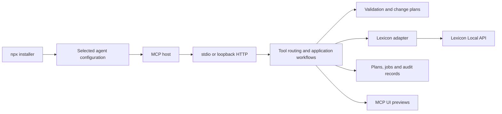

# Architecture

The server is a local integration process. Lexicon remains the authority for library data; the MCP host supplies the language model.

MCP and CLI adapters handle wire formats, authentication, and presentation. Application services orchestrate operations and workflows. Domain validation and change policy remain transport-independent. Infrastructure provides HTTP, local storage, and locking. Feature modules own their schemas and behavior.

The Lexicon adapter uses documented API operations. It encodes GET parameters and sends JSON mutation bodies. Reads have bounded concurrency/retries; writes are serialized and coordinated across local processes. Ambiguous writes are never automatically replayed. Commands distinguish direct operations, asynchronous dispatch, dialog launch, and unsupported actions.

Change plans retain explicit IDs, before-values, desired edits, and a content hash. Application revalidates snapshots and records per-operation progress. Jobs persist reports without replaying interrupted work. Atomic JSON writes and JSONL logs avoid a native database dependency.

## Installation and distribution

esbuild produces a bundled CommonJS Node.js 24 program. One platform-neutral tarball contains the CLI, installer, MCP server, embedded preview assets, license notices, and SBOM. It is executed by `npx` directly from a GitHub release, without npm registry publication.

The installer adapts selected agents' native configuration formats, preserves unrelated settings, detects conflicts, and backs up modifications. It copies the bundled runtime to persistent user storage and records an absolute Node command and stable bundle path. A dry run produces no configuration or runtime files. Installer tests use isolated paths, never the user's real agent settings.

## Preview boundary

MCP UI resources provide previews and explicit Apply/Cancel controls. The app-only confirmation tool requires a short-lived credential delivered only in UI-private metadata. MCP form elicitation supplies a native review dialog where embedded Apps are unavailable, using a signed continuation bound to the exact plan and request. No client capability means no protected apply; text/JSON remains available for inspection. The UI never bypasses stale-plan validation or read-only mode.

Planning, inspection, and display are separate. `presentation.ts` declares the tools that render UI; only `lexicon_review_change_plan` renders change plans and issues their credentials. Read-only report display rejects plan-shaped data. Confirmation updates the existing component without advertising another template. The component declares both color schemes before first paint, applies the host's selected scheme and style tokens, and leaves the document canvas transparent.

## Decisions

- Use official Lexicon APIs; avoid database writes and unattended UI automation.
- Keep stdio as the default and authenticate loopback HTTP.
- Require explicit UI decisions for protected writes; do not accept chat confirmation as approval.
- Ship a Node package with an interactive selected-agent installer.
- Generate dependency license notices and a build/runtime component inventory.
- Publish prereleases for successful main builds; manually select stable releases.
- Keep npm registry publication disabled until separately configured.

Handwritten source and test files stay below 400 lines. Upstream specifications, generated schemas, and synthetic fixtures are exempt. CI checks sizes, dependency boundaries, types, and behavior.
