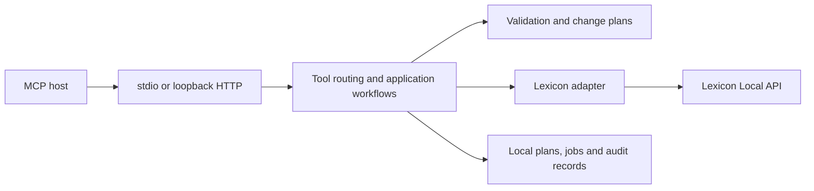

# Architecture

The server is a local integration process. Lexicon remains the authority for library data; the MCP host supplies the language model. The optional plugin is a set of read-only reports running in Lexicon's protected JavaScript environment.

MCP and CLI adapters handle wire formats, authentication, and presentation. Application services orchestrate operations and workflows. Domain validation and change policy are transport-independent. Infrastructure adapters provide HTTP, local storage, and locking. Tool handlers stay thin; feature modules own their own schemas and behavior.

The Lexicon adapter uses only documented API operations. It encodes GET query parameters and sends JSON bodies for mutations. Reads have bounded concurrency/retries; writes are serialized and coordinated across local processes. Ambiguous writes are never automatically replayed. Capability metadata distinguishes direct operations, asynchronous dispatch, interactive dialog launch, and unsupported commands.

Change plans store explicit IDs, before-values, desired values, and a content hash. Plans are revalidated before application and record progress per operation. Jobs persist state and reports without automatically replaying interrupted work. Atomic JSON writes and JSONL logs avoid a native database dependency.

The bundled executable and Node tarball share the same CLI bundle. esbuild emits CommonJS for Node 24's single-executable application support. Each release target embeds its matching Node runtime; platform runners build and smoke-test their own binaries.

Handwritten source and test files are limited to 400 lines. Upstream specifications, generated schemas, and synthetic fixtures are exempt. CI checks file sizes and dependency boundaries. Split features by behavior instead of growing a single server file.

## Decisions

- Use official APIs for compatibility and maintainability; no private database writes or unattended UI automation.
- Keep stdio as the default; local authenticated HTTP serves clients that need it.
- Use client-mediated confirmation, avoiding an extra review UI or permanent bridge daemon.
- Keep the companion optional and read-only.
- Bundle runtime dependencies and generate a complete build/runtime dependency inventory for release review.
- Publish prereleases after successful main builds and support manually selected stable releases. Keep npm publication disabled.
