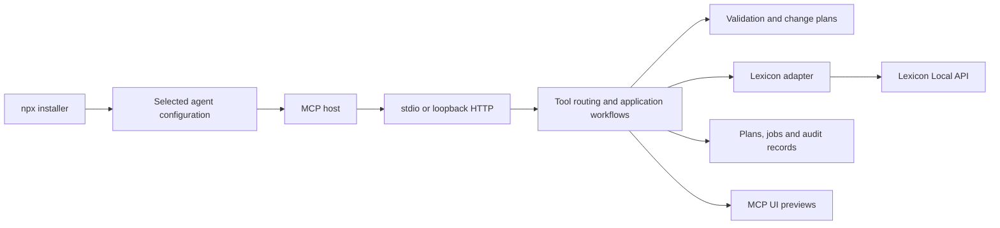

# Architecture

The server is a local integration process. Lexicon remains the authority for library data; the MCP host supplies the language model.

MCP and CLI adapters handle wire formats, authentication, and presentation. Application services orchestrate operations and workflows. Domain validation and change policy remain transport-independent. Infrastructure provides HTTP, local storage, and locking. Feature modules own their schemas and behavior.

The Lexicon adapter uses documented API operations. It encodes GET parameters and sends JSON mutation bodies. Reads have bounded concurrency/retries; writes are serialized and coordinated across local processes. Ambiguous writes are never automatically replayed. Commands distinguish direct operations, asynchronous dispatch, dialog launch, and unsupported actions.

Change plans retain explicit IDs, before-values, desired edits, and a content hash. Application revalidates snapshots and records per-operation progress. Jobs persist reports without replaying interrupted work. Atomic JSON writes and JSONL logs avoid a native database dependency.

## Installation and distribution

esbuild produces a bundled CommonJS Node.js 24 program. One platform-neutral tarball contains the CLI, installer, MCP server, embedded preview assets, license notices, and SBOM. It is executed by `npx` directly from a GitHub release, without npm registry publication.

The installer adapts selected agents' native configuration formats, preserves unrelated settings, detects conflicts, and backs up modifications. It copies the bundled runtime to persistent user storage and records an absolute Node command and stable bundle path. A dry run produces no configuration or runtime files. Installer tests use isolated paths, never the user's real agent settings.

## Preview boundary

MCP UI resources are read-only presentations. `lexicon_preview_change_plan` is the sole plan-widget renderer; it uses the saved plan and has no write controls, credentials, or tool-call bridge. The renderer works independently of approval. Automatic review prefers advertised native MCP forms, using a signed continuation bound to the exact plan and request. A deliberate per-review `approval: "chat"` option handles user-reported missing/broken native controls or an explicit request for chat approval.

When automatic review finds no native forms, or chat review is deliberately requested, `chat-review.ts` stores a short-lived review marker in `chat-reviews`. A later explicit chat decision binds the plan ID/hash and uses the existing internal approval manager, preserving stale/read-only/replay guards. Advertising forms does not authorize a direct chat decision: a prior exact-plan chat review is required. The assistant relays actual chat consent; the server cannot inspect the transcript. Dismissing a native form never starts a chat review automatically. Serialized decision records survive fresh HTTP server instances and prevent duplicate writes.

Planning and inspection return compact summaries and bounded detail pages, avoiding large before snapshots in model-visible output. Full authoritative plans remain in storage. `presentation.ts` separates summaries, display, and review guidance. Read-only report display rejects plan-shaped data in favor of the dedicated saved-plan preview. The component declares both color schemes before first paint, follows host styles, and keeps its canvas transparent.

## Decisions

- Use official Lexicon APIs; avoid database writes and unattended UI automation.
- Keep stdio as the default and authenticate loopback HTTP.
- Require a saved plan for every persistent library write. Prefer native forms automatically; allow deliberate chat review for missing/broken controls or an explicit user request.
- Ship a Node package with an interactive selected-agent installer.
- Generate dependency license notices and a build/runtime component inventory.
- Publish prereleases for successful main builds; manually select stable releases.
- Keep npm registry publication disabled until separately configured.

Handwritten source and test files stay below 400 lines. Upstream specifications, generated schemas, and synthetic fixtures are exempt. CI checks sizes, dependency boundaries, types, and behavior.
